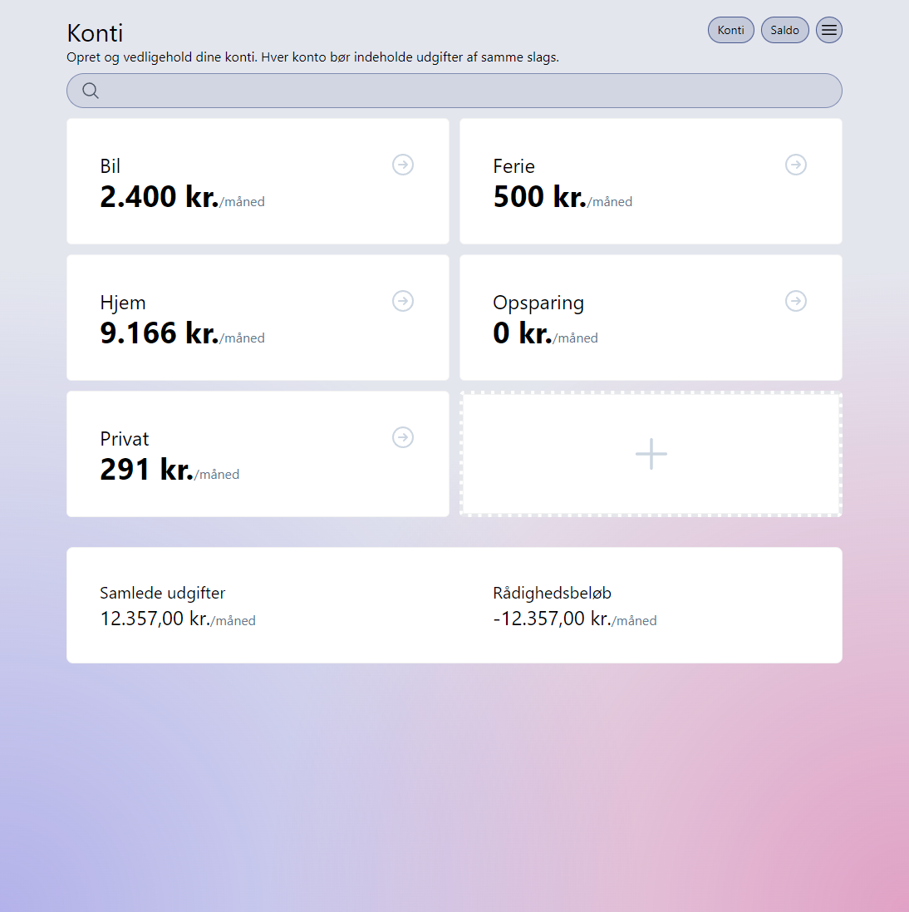

## Svelte budget planner

Simple budget planning application, built using SvelteKit.



### Tech stack

- SvelteKit
- Better Auth (GitHub OAuth)
- Drizzle (PostgreSQL)
- Skeleton UI
- TypeScript
- Tailwind CSS
- Playwright (End-to-end tests)
- Vitest (Unit tests)

### What can it do?

The budget planner allows you to manage your expenses in a simple user interface. The application keeps track of payment
dates, which it uses to calculate the required account balances to avoid overdrawing.

### Try it out 🚀

I'm hosting the app [here on Vercel](https://svelte-budget-planner.vercel.app/). You can sign in using your GitHub
account.

### Installation

If you want to run it yourself, you can follow these instructions.

I use the Vercel CLI to link the application with my project in Vercel and pull local environment
variables ([Read more](https://vercel.com/docs/cli)).

```bash
pnpm dlx vercel link
```

```bash
pnpm dlx vercel env pull
```

### Environment variables

The following environment variables are needed.

#### Better Auth

The app supports GitHub sign-in.

```
AUTH_GITHUB_ID=
AUTH_GITHUB_SECRET=
BETTER_AUTH_SECRET=
```

#### Playwright

`PLAYWRIGHT_BASE_URL` is optional. It defaults to `http://localhost:3000`; set it only when running the end-to-end tests against another host.

```
PLAYWRIGHT_BASE_URL=https://svelte-budget-planner.vercel.app
```

#### PostgreSQL

The Neon PostgreSQL database connection requires:

```
DATABASE_URL=
```
